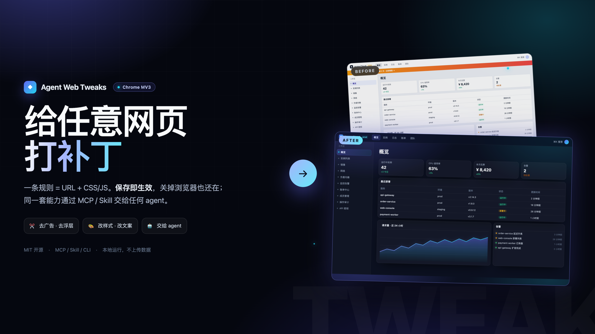
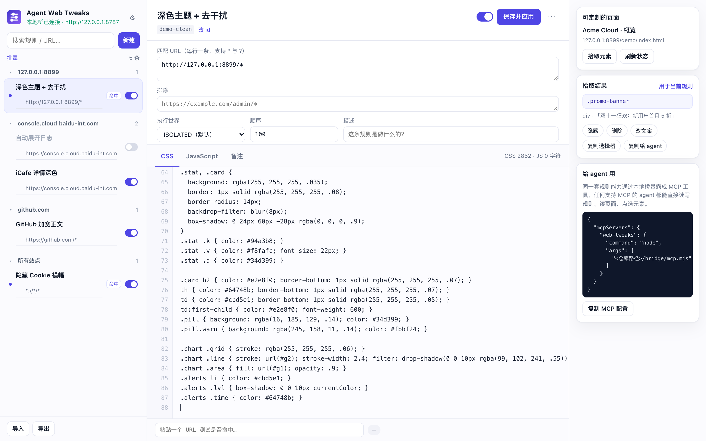
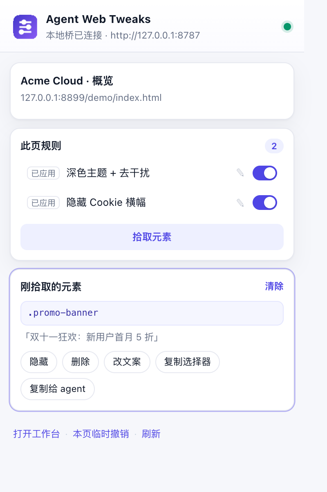
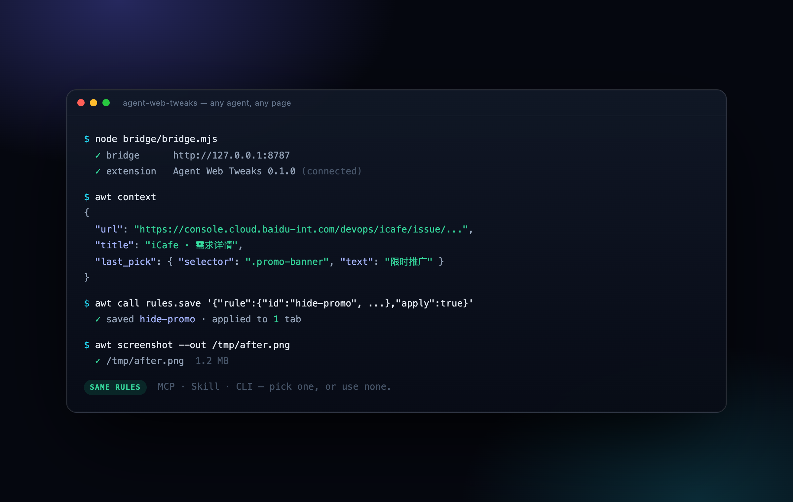

<div align="center">



# Agent Web Tweaks

**给任意网页打补丁。保存即生效，关掉浏览器还在；同一套规则，任何 agent 都能用。**

[](#)
[](#给-agent-用)
[](#skill)
[](#)
[](LICENSE)

</div>

---

一条规则 = **URL 通配符 + 一段 CSS + 一段 JS**。

在页面上点一下元素就能生成规则；规则注册成 `document_start` 的 userScript，刷新、SPA 路由切换、重开浏览器都自动生效。
规则本身是结构化数据，于是 **MCP / Skill / CLI** 都能读写它——agent 读完页面就能写规则、应用、截图确认。

<div align="center">

</div>

---

## 它到底解决了什么

| 以前的痛点 | 现在 |
| --- | --- |
| 想去掉一个广告位，要开 DevTools 翻 DOM、抄类名、写脚本 | 点一下元素 → 点「隐藏」，规则就写好了 |
| Stylus 只能改 CSS，改文案 / 自动点击要另找脚本 | CSS 和 JS 写在同一条规则里，共享一个 `tweak` SDK |
| 改完刷新就没了，SPA 切个路由又回来 | 规则持久化 + 路由监听，切走自动撤、切回自动上 |
| 想让 agent 帮忙改页面，它只能“说”，改不了 | agent 调 `page.context` / `rules.save`，改完还能 `page.screenshot` 验收 |
| 脚本/插件各有一套格式，agent 学不会 | 规则是一个 JSON：`id / match / css / js / world` |
| 从 Tampermonkey 搬脚本要手抄元数据 | 工作台「导入」直接读 `.user.js`，`@match` / `@exclude` / `@grant` 自动映射 |
| 脚本想跨域请求，被 CORS 挡住 | 规则里 `tweak.fetch()` 由扩展身份发出，不受页面 CORS 限制（按域名授权） |

## 30 秒上手

1. `chrome://extensions` → 打开「开发者模式」→「加载已解压的扩展程序」→ 选本目录
2. 扩展详情里打开 **「允许用户脚本」**（只有 JS 规则需要；CSS 规则装完就能用）
3. 点扩展图标 → **「拾取元素」** → 在页面上点一下广告 / 浮层 → 点「隐藏」

就这样。想再细调，点「打开工作台」。

> 需要 Chrome 120+。规则只存在本机 `chrome.storage.local`，不上传任何数据。

## 界面

<div align="center">

</div>

工作台是完整编辑器：CSS / JS 双栏、行号、URL 命中测试、按站点分组、批量启用/停用/删除、模板、导入导出、本地桥设置。

<div align="center">

</div>

弹窗是随手用的那层：本页命中哪些规则、逐条开关、拾取元素、一键生成「隐藏 / 删除 / 改文案」，以及「复制给 agent」。

## 给 agent 用

<div align="center">

</div>

扩展通过本地桥暴露 **18 个工具**：`rules.*`（增删改查 / 导入导出）、`page.*`（上下文 / HTML / 文本 / 执行 JS / 截图 / 拾取 / 应用 / 撤销）、`tabs.list`、`meta.status`。

### MCP

```json
{
  "mcpServers": {
    "web-tweaks": {
      "command": "node",
      "args": ["<repo>/bridge/mcp.mjs"]
    }
  }
}
```

Claude Code：

```bash
claude mcp add web-tweaks -- node <repo>/bridge/mcp.mjs
```

### Skill

不依赖 MCP 客户端，Codex / Claude Code 这类带 skills 的 agent 直接装：

```bash
node skill/install.mjs          # 装到 ~/.codex/skills 和 ~/.claude/skills
node ~/.codex/skills/web-tweaks/scripts/awt.mjs status
```

```bash
awt up                    # 需要时后台起桥
awt context               # 当前页面（含用户最后一次拾取的元素）
awt pick                  # 让用户在页面上点一个元素
awt save @rule.json       # 写完立刻应用
awt screenshot --out p.png
```

### CLI / curl

```bash
node bridge/bridge.mjs     # 默认 http://127.0.0.1:8787
node bridge/cli.mjs tools

curl -s http://127.0.0.1:8787/call \
  -H 'content-type: application/json' \
  -d '{"tool":"rules.save","args":{"rule":{"id":"hide-promo","name":"去掉推广位","match":["https://example.com/*"],"css":".promo{display:none!important}"},"apply":true}}'
```

### 一个完整回合

```text
你：把当前页面那个推广条去掉
agent → page.context          # 看到 last_pick.selector = ".promo-banner"
agent → rules.save {...}      # 写入并应用
agent → page.screenshot       # 截图确认
你：以后都这样 ✓
```

## 规则长什么样

```jsonc
{
  "id": "hide-promo",
  "name": "去掉首页推广条",
  "match": ["https://example.com/*", "https://www.example.com/*"],
  "exclude": ["https://example.com/admin/*"],
  "world": "ISOLATED",
  "order": 100,
  "enabled": true,
  "css": ".promo-banner, [class*=\"sponsor\"] { display: none !important; }",
  "js": ""
}
```

- `match`：URL 通配符，`*` 任意字符、`?` 单字符；不写协议会自动补 `*://`
- `world`：`ISOLATED`（默认，跑在 USER_SCRIPT 隔离世界）/ `MAIN`（页面主世界，可改 `window.fetch`）
- 规则 JS 在 `document_start` 执行，动 DOM 用 `tweak.ready(...)` 或 `await tweak.waitFor(...)`

### 从 Tampermonkey 迁移

工作台 →「导入」→ 选 `.user.js`：`@match` / `@include` / `@exclude` 映射成规则，`@grant none` 的脚本落到 MAIN 世界，其余落到隔离世界，并自动提供 `GM_addStyle` / `GM_getValue` / `GM_setValue` / `GM_deleteValue` / `GM_listValues` / `GM_log` / `GM_xmlhttpRequest` 的兼容实现。

> `@require` 不会自动下载、正则形式的 `@match` 会跳过——导入时会列出这些提示。

### 跨域请求

```js
const res = await tweak.fetch("https://api.github.com/repos/…", {
  headers: { accept: "application/json" },
});
const data = await res.json();   // { ok, status, text, json(), headers }
```

请求由 background 用扩展权限发出，不受页面 CORS 限制；**跨域域名要先在工作台 → 设置 → 跨域请求里授权**（同源默认放行），可以选是否携带 Cookie。

### `tweak` SDK

| API | 说明 |
| --- | --- |
| `tweak.$(sel)` / `tweak.$$(sel)` | 查询元素 |
| `tweak.waitFor(sel, { timeout })` | 等元素出现，超时返回 `null` |
| `tweak.observe(cb, { throttleMs, immediate })` | 监听 DOM 变化（自带节流与熔断） |
| `tweak.css(text)` | 运行时插样式，自动清理 |
| `tweak.ready(fn)` / `tweak.onRoute(fn)` | DOM 就绪 / SPA 路由变化 |
| `tweak.onCleanup(fn)` | 规则被停用、删除、不再匹配时执行 |
| `tweak.store.get/set(key)` | 每条规则一份持久小存储 |
| `tweak.fetch(url, opts)` | 跨域请求（走扩展身份，按域名授权） |
| `tweak.log(...)` | 带规则 id 的日志 |

```js
// 自动展开 + 只展开一次
const btn = await tweak.waitFor(".toc-toggle");
if (btn && !tweak.store.get("opened")) {
  btn.click();
  tweak.store.set("opened", true);
}
```

## 它是怎么跑起来的

```
┌────────────┐   document_start 注入 CSS / 注册 userScript   ┌──────────────────┐
│  Chrome    │ ◀────────────────────────────────────────── │  background SW    │
│  页面       │ ────── awt:applied / awt:picked ───────────▶ │  规则 / 拾取 / 桥  │
└────────────┘                                              └────────┬─────────┘
                                                                     │ SSE
                                                          ┌──────────▼─────────┐
                                                          │ bridge.mjs (本地)   │
                                                          │  POST /call        │
                                                          └──────────┬─────────┘
                                                     MCP / Skill / CLI / curl
```

- **CSS**：内容脚本在 `document_start` 直读 storage 注入 `<style>`，首屏基本不闪
- **JS**：每条规则注册成一个 `chrome.userScripts` 脚本，绕开页面 CSP，也不用 `eval`
- **SPA**：`popstate` / `hashchange` + 轮询 URL，路由变化自动增删
- **熔断**：规则里的 `MutationObserver` 每秒回调超 3000 次会被自动断开并记录错误

## 安全

- 本地桥只监听 `127.0.0.1`，可用 `--token` 开启校验
- 规则 JS 在隔离世界运行：能操作 DOM，但拿不到页面闭包变量
- `world: "MAIN"` 的规则拥有页面权限，只在你信任的规则上开
- 规则、拾取结果、错误都只存在本机

## 开发

```
src/
  background.js          service worker：规则、注入、拾取、本地桥
  content/tweaker.js     document_start 运行时（CSS + 路由）
  shared/core.js         规则模型（纯函数，浏览器与 Node 共用）
  shared/runtime.js      规则运行时（userScripts 里执行的那段）
  shared/tools.js        工具清单（扩展与 MCP 共用）
bridge/                  bridge.mjs / mcp.mjs / cli.mjs（零依赖）
skill/web-tweaks/        可安装的 skill（SKILL.md + awt.mjs）
docs/                    demo 页、截图、落地页
tests/                   规则模型 + 桥 + MCP + 真浏览器冒烟
```

```bash
node tests/run.mjs                 # 26 项：规则模型、桥、MCP

npm i -D puppeteer-core            # 浏览器冒烟测试需要
CHROME="/path/to/Chrome for Testing" node tests/browser.mjs
```

浏览器测试会真的加载扩展，在严格 CSP 页面上验证 CSS/JS、MAIN world、SPA 路由、截图、拾取与两个 UI 页面。

## License

[MIT](LICENSE)
